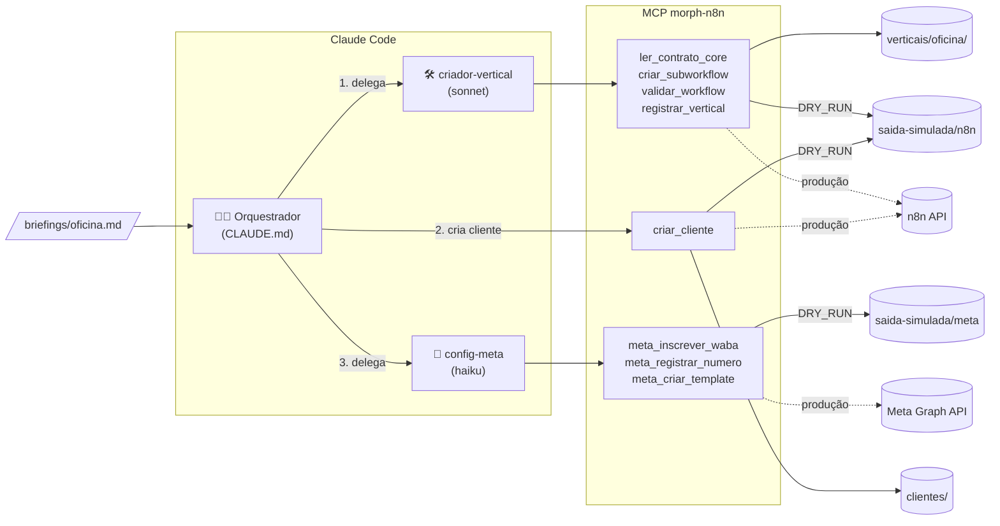

# Morph — Fábrica de Produtos

> **Demo.** Agentes do Claude Code que criam sozinhos um produto novo da Morph — um bot de WhatsApp com IA
> rodando no n8n — para um segmento novo. Nesta demo, os agentes criam o vertical **oficina mecânica**
> a partir do nosso bot de **consultórios odontológicos**.
>
> Tudo roda em **modo simulação** (`DRY_RUN=true`): nada é enviado ao n8n nem à Meta. O que *seria*
> enviado fica gravado em `saida-simulada/`.

---

## O problema

Hoje, criar um produto novo (um bot para outro segmento) é **manual**:

- o workflow do odonto foi construído para o odonto: webhook, histórico, LLM, regras e integrações
  estão todos misturados num workflow só;
- para outro segmento, alguém precisa duplicar o workflow, caçar o que é específico, reescrever
  prompt e ferramentas e testar tudo na mão;
- configurar o WhatsApp de cada cliente (WABA, número, templates) também é manual.

Resultado: cada vertical novo custa semanas e cada cliente novo custa horas.

## A solução: core + verticais + agentes

Separamos o bot em três camadas:

| Camada | O que é | Muda quando |
|---|---|---|
| **Core** | Parte genérica: webhook da Meta, histórico, chamada do LLM, envio de resposta, transbordo humano | quase nunca |
| **Vertical** | Pacote de um segmento: `prompt.md` + **tools** (cada tool = um subworkflow n8n) | surge um segmento novo |
| **Cliente** | Uma empresa usando um vertical: config JSON (nome, horários, número de WhatsApp…) | entra um cliente novo |

Todo vertical segue um **contrato curto** ([core/contrato-core.md](core/contrato-core.md)): formato de
entrada e saída das tools, variáveis do prompt e convenções de nomes. Como o contrato é pequeno e
explícito, **um agente de IA consegue criar um vertical inteiro sozinho**.



### Os agentes

- **Orquestrador** ([CLAUDE.md](CLAUDE.md)) — não escreve workflows. Lê o briefing, delega, **confere**
  o resultado (arquivos existem, `vertical.json` válido), cria um cliente de exemplo e gera o relatório.
- **criador-vertical** ([.claude/agents/criador-vertical.md](.claude/agents/criador-vertical.md)) — lê
  só o contrato e **um** exemplo de tool do odonto. Escreve o `prompt.md` e cria as tools uma a uma:
  `criar_subworkflow → validar_workflow → corrige se houver erro`. No fim, `registrar_vertical`.
- **config-meta** ([.claude/agents/config-meta.md](.claude/agents/config-meta.md)) — inscreve o app na
  WABA, registra o número, cria o template de boas-vindas e gera o **checklist do que exige ação humana**.

### O MCP `morph-n8n`

Servidor MCP local (Node + TypeScript, stdio) em [mcp/morph-n8n/](mcp/morph-n8n/). É a **única** porta
de saída dos agentes para o n8n e a Meta — por isso dá para trocar simulação por produção mudando só o `.env`.

| Ferramenta | Simulação (`DRY_RUN=true`) | Produção (`DRY_RUN=false`) |
|---|---|---|
| `ler_contrato_core()` | lê `core/contrato-core.md` | igual |
| `listar_verticais()` | lista `verticais/` | igual |
| `criar_subworkflow(nome, vertical, workflow_json)` | valida, salva a tool, grava o request em `saida-simulada/n8n/`, devolve id falso | `POST /api/v1/workflows` |
| `validar_workflow(id, payload_teste)` | validação estática: trigger, nós conectados, IF `Args ok?` antes da API, nó `Retorno` com `{ texto, dados }`, formato do payload | mesma validação sobre o workflow publicado |
| `registrar_vertical(nome, descricao, tools[])` | grava `verticais/<nome>/vertical.json` | igual |
| `criar_cliente(vertical, config)` | grava `clientes/<id>.json` e monta o workflow do cliente (core + tools) | publica o workflow no n8n |
| `meta_inscrever_waba(waba_id)` | grava o request em `saida-simulada/meta/` | `POST /{waba_id}/subscribed_apps` |
| `meta_registrar_numero(phone_number_id, pin)` | idem (PIN mascarado) | `POST /{phone_number_id}/register` |
| `meta_criar_template(waba_id, template)` | idem | `POST /{waba_id}/message_templates` |

Toda resposta em simulação começa com **`[SIMULADO]`**, e o servidor escreve logs legíveis no stderr.

## Estrutura

```
morph-fabrica/
├─ CLAUDE.md                  instruções do orquestrador
├─ .mcp.json                  registra o MCP local morph-n8n
├─ .env.example               N8N_URL, N8N_API_KEY, META_TOKEN, DRY_RUN=true
├─ .claude/agents/            criador-vertical.md, config-meta.md
├─ .claude/commands/          criar-produto.md  →  /criar-produto <vertical>
├─ core/                      contrato-core.md + core.workflow.json (esqueleto genérico)
├─ verticais/odonto/          vertical de exemplo (vertical.json, prompt.md, tools/)
├─ clientes/                  clinica-exemplo.json
├─ briefings/oficina.md       briefing do vertical novo
├─ saida-simulada/            o que o MCP "enviaria" ao n8n/Meta (fora do git)
├─ exemplos/demo-oficina/     resultado de uma execução real (plano B da apresentação)
├─ scripts/resetar-demo.mjs   zera o que os agentes geraram
└─ mcp/morph-n8n/             servidor MCP (Node + TypeScript) + testes
```

## Como rodar a demo

Pré-requisitos: **Node.js 18+** e **Claude Code**.

```bash
# 1. Build do MCP
cd mcp/morph-n8n
npm install
npm run build
cd ../..

# 2. (opcional) .env — sem ele o padrão já é DRY_RUN=true
cp .env.example .env

# 3. Abrir o Claude Code na pasta do projeto
claude
```

No Claude Code:

```
/mcp                      ← confira que "morph-n8n" aparece conectado
/criar-produto oficina
```

O que acontece:

1. o orquestrador lê `briefings/oficina.md` e delega ao **criador-vertical**;
2. o criador-vertical escreve `verticais/oficina/prompt.md` e cria cada tool (agendar revisão, status da
   OS, peças em estoque, lembrete de revisão, orçamento), validando e corrigindo uma por uma;
3. o orquestrador confere os arquivos e cria o cliente **Auto Center Exemplo** (`clientes/oficina-*.json`);
4. o **config-meta** configura o WhatsApp do cliente (simulado) e gera o checklist humano;
5. o relatório final fica em `saida-simulada/relatorio-oficina.md`.

Para mostrar aos sócios: abra `saida-simulada/n8n/` (os workflows que seriam publicados — dá para
importar qualquer `request.body` no editor do n8n) e `saida-simulada/meta/` (os requests à Graph API).

### Rodar de novo do zero

```bash
node scripts/resetar-demo.mjs --sim   # mostra o que seria apagado
node scripts/resetar-demo.mjs         # apaga o que os agentes geraram (mantém odonto e clinica-exemplo)
```

### Plano B para a apresentação

Em [exemplos/demo-oficina/](exemplos/demo-oficina/) está o resultado de uma execução real do
`/criar-produto oficina`: vertical, cliente, workflows e requests simulados e o relatório. Se a internet
ou o tempo falharem na hora, mostre essa pasta. Os agentes geram tools um pouco diferentes a cada execução.

## Desenvolvimento

```bash
cd mcp/morph-n8n
npm test                      # build + testes do validador (inclui: as tools do odonto continuam válidas)
npm run validar -- oficina    # valida pelo terminal todas as tools de um vertical
```

O CI do GitHub ([.github/workflows/ci.yml](.github/workflows/ci.yml)) roda build e testes a cada push.
Depois de mudar o código do MCP, rode `npm run build` e reconecte o servidor no Claude Code (`/mcp`).

## Ver os agentes trabalhando (Habblaud)

O [Habblaud](https://github.com/marmottajr/habblaud) (open source) mostra as sessões do Claude Code como
personagens num escritório em pixel art: dá para ver o orquestrador delegando e os subagentes
`criador-vertical` e `config-meta` trabalhando em tempo real — ótimo para apresentar.

```bash
git clone https://github.com/marmottajr/habblaud.git
cd habblaud
npm install
npm run build && npm start      # ou: npm run docker:up
npm run mod:install             # conecta ao Claude Code (reabra a sessão ou use /reload-plugins)
```

Abra **http://localhost:4747** e, em outra janela, rode `/criar-produto oficina` no Claude Code.
Se clonar o Habblaud dentro desta pasta, tudo bem: `habblaud/` está no `.gitignore`.

> O Habblaud roda em macOS/Linux. No Windows, use **WSL** ou a opção **Docker**. Ele só lê os arquivos
> de sessão que o Claude Code já grava em `~/.claude*/` e escuta apenas em 127.0.0.1.

## Próximos passos para virar produção

1. **Desligar a simulação** — `DRY_RUN=false` no `.env`.
2. **Credenciais do n8n** — `N8N_URL` e `N8N_API_KEY` (Settings → n8n API). Criar no n8n as credenciais
   usadas pelos nós (Anthropic, Postgres do histórico, WhatsApp) e a variável `MORPH_API_URL`.
3. **Extrair o core de verdade** — refatorar o workflow atual do odonto para o formato
   `core.workflow.json` + `verticais/odonto/`, e migrar os clientes atuais para `clientes/*.json`.
4. **Meta: tornar-se Tech Provider** — verificar o Business Manager da Morph, criar o app, passar no
   App Review e habilitar o **Embedded Signup**, para o cliente conectar o WhatsApp dele em poucos cliques
   e a Morph receber o `waba_id`/`phone_number_id` automaticamente. `META_TOKEN` = token de System User.
5. **Teste de verdade** — trocar a validação estática por execução real das tools com `payload_teste`
   (n8n de staging) antes de publicar.
6. **Painel próprio** — receber eventos do n8n (execuções, erros, transbordos, mensagens por cliente)
   e mostrar status de cada cliente/vertical, incluindo o checklist de ações humanas da Meta.
